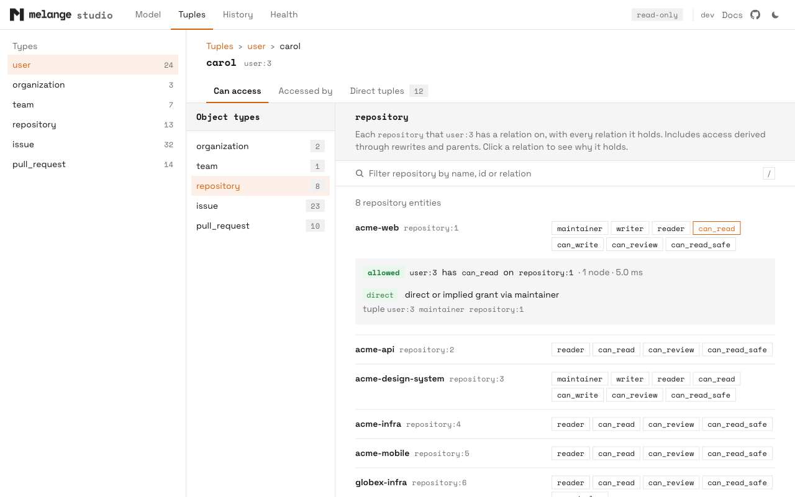
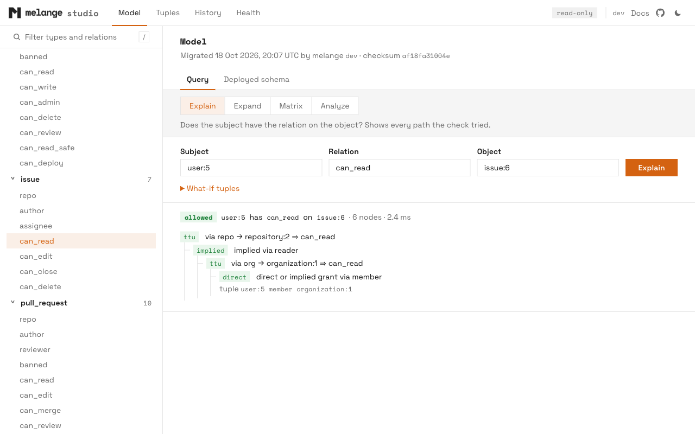
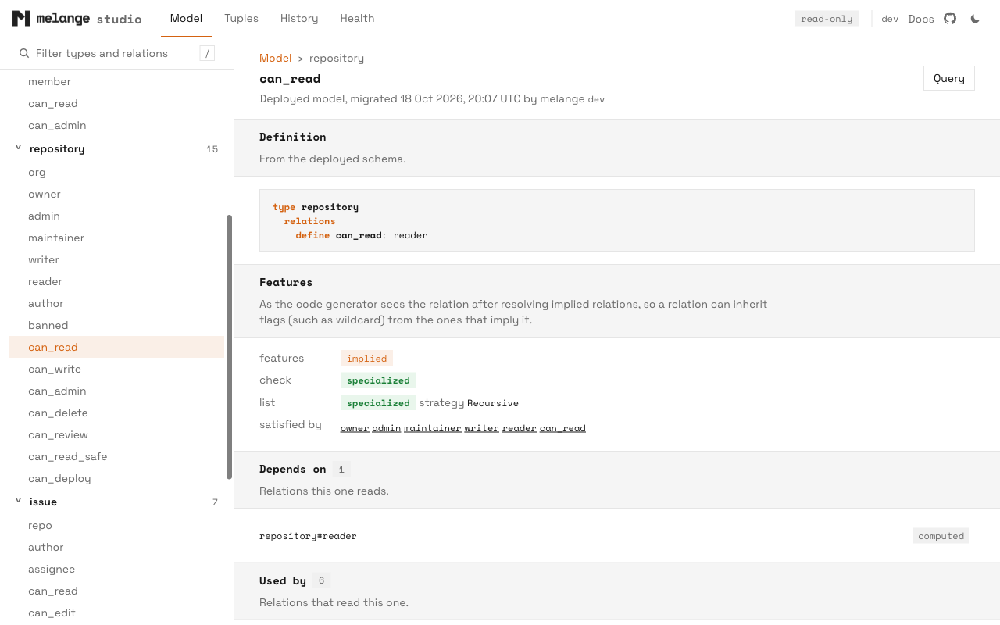
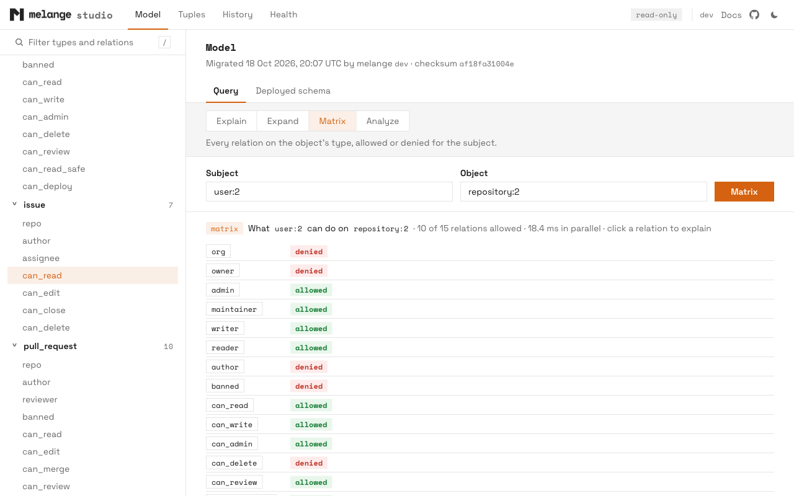

<p align="center">
  
</p>

---

# Melange


[](https://pkg.go.dev/github.com/pthm/melange)
[](https://goreportcard.com/report/github.com/pthm/melange/melange)
[](https://codecov.io/gh/pthm/melange)
[](https://matrix.to/#/#melange:matrix.org)

**An OpenFGA-to-PostgreSQL authorization compiler.**

Melange compiles [OpenFGA](https://openfga.dev) authorization schemas into specialized PL/pgSQL functions that run inside your PostgreSQL database. Like [Protocol Buffers](https://protobuf.dev/) compiles `.proto` files into serialization code, Melange compiles `.fga` files into SQL functions for [Zanzibar](https://research.google/pubs/pub48190/)-style relationship-based access control.

The generated functions read a `melange_tuples` view you define over your existing domain tables. There is no separate tuple store and nothing to sync.

> [!NOTE]
> **📚 Documentation:** guides, API reference and examples at **[melange.sh](https://melange.sh)**.

## Why Melange?

Most authorization systems run as a separate service that you keep in sync with your application data. Melange is a compiler instead.

**At migration time**, `melange migrate` parses your OpenFGA schema, analyzes each relation's patterns (direct, union, exclusion, tuple-to-userset and so on), resolves role hierarchies, and installs a specialized SQL function per relation.

**At runtime**, a permission check is a single SQL function call, `check_permission()`, which runs those functions against your `melange_tuples` view.

That gives you:

- **Always in sync.** Checks read your tables directly, with no replication lag.
- **Transaction-aware.** Checks see uncommitted changes in the same transaction, so they work in triggers and RLS policies.
- **Any language.** Anything that can run SQL can check permissions. Go and TypeScript clients are optional conveniences.
- **No recursive lookups.** Role hierarchies are resolved at compile time and inlined into the generated SQL.
- **OpenFGA compatible.** Every Schema 1.1 feature except conditions, validated against the official OpenFGA test suite.

Inspired by [OpenFGA](https://openfga.dev) and built on ideas from [pgFGA](https://github.com/rover-app/pgfga).

## Installation

**Homebrew** (macOS and Linux):

```bash
brew install pthm/tap/melange
```

**Scoop** (Windows):

```powershell
scoop bucket add pthm https://github.com/pthm/scoop-bucket
scoop install pthm/melange
```

**Go:**

```bash
go install github.com/pthm/melange@latest
```

**Container image:**

```bash
docker pull ghcr.io/pthm/melange:latest
```

**Binaries and Linux packages:** `.tar.gz`, `.zip`, `.deb`, and `.rpm` for Linux, macOS, and Windows on [GitHub Releases](https://github.com/pthm/melange/releases). macOS binaries are code-signed. See the [installation guide](https://melange.sh/docs/getting-started/installation/) for package, Docker, and checksum instructions.

The CLI tells you when a newer release is available. Pass `--no-update-check` to turn that off.

**Runtime libraries** (optional):

```bash
go get github.com/pthm/melange/melange   # Go, standard library only
npm install @pthm/melange                # TypeScript
```

## Quick Start

### 1. Define your schema

```fga
model
  schema 1.1

type user

type repository
  relations
    define owner: [user]
    define reader: [user] or owner
    define can_read: reader
```

`melange init` creates a config file and a starter schema for you.

### 2. Map your tables to tuples

Create a `melange_tuples` view over the tables that already hold your authorization data:

```sql
CREATE VIEW melange_tuples AS
SELECT
  'user' AS subject_type,
  user_id::text AS subject_id,
  'owner' AS relation,
  'repository' AS object_type,
  repo_id::text AS object_id
FROM repository_owners
UNION ALL
SELECT 'user', user_id::text, 'reader', 'repository', repo_id::text
FROM repository_readers;
```

### 3. Compile the schema into SQL functions

```bash
melange migrate --db postgres://localhost/mydb --schema schema.fga
```

This installs `check_permission()`, `list_accessible_objects()`, `list_accessible_subjects()`, and a specialized check function for each relation.

### 4. Check permissions

**SQL**, from any language:

```sql
SELECT check_permission('user', 'alice', 'can_read', 'repository', 'my-repo');
-- 1 (allowed) or 0 (denied)
```

**Go:**

```go
checker := melange.NewChecker(db)

allowed, err := checker.Check(ctx,
    melange.Object{Type: "user", ID: "alice"},
    melange.Relation("can_read"),
    melange.Object{Type: "repository", ID: "my-repo"},
)
```

**TypeScript:**

```typescript
const checker = new Checker(pool);

const decision = await checker.check(
  { type: "user", id: "alice" },
  "can_read",
  { type: "repository", id: "my-repo" },
);
if (decision.allowed) { /* ... */ }
```

### 5. Generate type-safe clients (optional)

```bash
melange generate client --runtime go --schema schema.fga --output ./authz/
melange generate client --runtime typescript --schema schema.fga --output ./src/authz/
```

```go
allowed, err := checker.Check(ctx, authz.User("alice"), authz.RelCanRead, authz.Repository("my-repo"))
```

## Inspect It With Studio

`melange studio` opens a local, read-only web console on any melange database. See what a user can access and who can access an object, explain a decision step by step, try a grant before you write it, and read the SQL melange generated for each relation. It reads the model from the database, so it needs only a connection.

```bash
melange studio --env staging
```

<picture>
  <source media="(prefers-color-scheme: dark)" srcset="docs/static/images/studio/entity-dark.webp">
  
</picture>

<table>
  <tr>
    <td width="33%">
      <picture>
        <source media="(prefers-color-scheme: dark)" srcset="docs/static/images/studio/query-explain-dark.webp">
        
      </picture>
      <p align="center"><b>Explain</b> any check, path by path</p>
    </td>
    <td width="33%">
      <picture>
        <source media="(prefers-color-scheme: dark)" srcset="docs/static/images/studio/relation-dark.webp">
        
      </picture>
      <p align="center"><b>Relations</b> with their analysis and generated SQL</p>
    </td>
    <td width="33%">
      <picture>
        <source media="(prefers-color-scheme: dark)" srcset="docs/static/images/studio/query-matrix-dark.webp">
        
      </picture>
      <p align="center"><b>Matrix</b> of every relation for a subject</p>
    </td>
  </tr>
</table>

Studio binds a loopback address, opens read-only connections, and loads nothing from other hosts. It is experimental. See the [Studio guide](https://melange.sh/docs/guides/studio/) for environments, privileges and every page.

## CLI

```
Schema
  migrate     Apply schema to database
  validate    Validate a schema
  status      Show schema, tuples, and deployed-model status
  diff        Show what changed between the deployed model and your local schema
  history     Show the migration history recorded in the database
  schema      Inspect the model deployed in a database
  explain     Show why a permission check returns true or false
  expand      Show who has a permission on an object
  doctor      Run health checks
  studio      Open a local, read-only web console for a database (experimental)

Client
  generate    Generate code from schema

Utility
  init        Initialize a new Melange project
  config      Configuration utilities
  env         Environment profile utilities
  version     Print version information
  license     Print license and third-party notices
```

A few common commands:

```bash
melange migrate --dry-run                      # print the SQL without applying it
melange diff                                   # compare your schema with the deployed one
melange explain user:alice can_read repository:42
melange expand repository:42 can_read
melange doctor --verbose
```

Commands read `melange.yaml` and support named environments (`--env staging`). See the [CLI reference](https://melange.sh/docs/reference/cli/).

## Contributing

Contributions are welcome. Melange is still evolving, and feedback, bug reports and improvements are appreciated.

- **Chat:** questions, ideas and help getting started in the [Matrix room](https://matrix.to/#/#melange:matrix.org).
- **Issues:** [bug reports and feature requests](https://github.com/pthm/melange/issues). For bugs, include steps to reproduce, expected and actual behavior, and any errors.
- **Security:** report vulnerabilities through [private vulnerability reporting](https://github.com/pthm/melange/security/advisories/new).
- **Pull requests:** fork, branch, run `just test`, and open a PR with a clear description. Include tests for new behavior. For larger changes, open an issue or ask on Matrix first so we can agree on the approach.

The [contributing guide](https://melange.sh/docs/contributing/) covers the architecture, testing and benchmarks.

## Resources

- **[Documentation](https://melange.sh):** guides, API reference and examples
- **[OpenFGA](https://openfga.dev):** the authorization model Melange implements
- **[Zanzibar paper](https://research.google/pubs/pub48190/):** Google's original authorization system
- **[pgFGA](https://github.com/rover-app/pgfga):** the PostgreSQL FGA implementation that inspired this project

## License

MIT License. See [LICENSE](LICENSE) for details.
