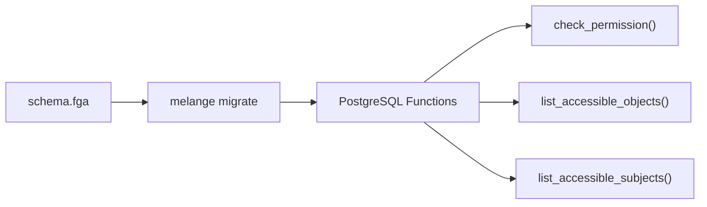

<div class="homepage-hero">
<div class="homepage-hero-text">


  <div class="hx:w-2 hx:h-2 hx:rounded-full hx:bg-primary-400"></div>
  <span>Free and open source on GitHub</span>
  


<div class="hx:mt-6 hx:mb-6">

  Zanzibar-Style Authorization for PostgreSQL

</div>

<div class="hx:mb-10">

  Fine-grained, relationship-based access control without an external service. Melange compiles OpenFGA schemas into SQL functions that run inside your existing database.

</div>

<div class="homepage-hero-buttons">


</div>

<ul class="homepage-facts">
  <li>MIT licensed</li>
  <li>PostgreSQL 14+</li>
  <li>Go and TypeScript clients</li>
  <li>SQL from any language</li>
</ul>

</div>
<div class="homepage-hero-demo">

<p class="homepage-demo-label">schema.fga</p>

```fga
type repository
  relations
    define org: [organization]
    define admin: [user]
    define can_read: member from org or admin
```

<p class="homepage-demo-label">Your application</p>

```sql
SELECT check_permission(
  'user', 'alice', 'can_read', 'repository', '123'
);
-- 1: alice is a member of the repository's org
```

</div>
</div>


  
  
  
  
  
  


<div class="homepage-release hx:mt-16">



</div>

<div class="homepage-section-gap"></div>

<div class="homepage-columns">
<div>


  How It Works


<div class="hx:mt-6"></div>

<div class="content">

Melange is an **authorization compiler**. Like Protocol Buffers or GraphQL Code Generator, you define a schema and Melange generates optimized code tailored to your exact model. Instead of a generic runtime that interprets your model at query time, Melange generates **purpose-built SQL functions** for each relation in your schema. Role hierarchies are resolved at compile time and inlined into SQL, so runtime checks only recurse where your data does, such as nested parent folders.

</div>
</div>
<div>



</div>
</div>

<div class="homepage-section-gap"></div>

<!-- Define Your Schema: 2-column -->
<div class="homepage-columns">
<div>

<p class="homepage-step">Step 1</p>


  Define Your Schema


<div class="hx:mt-6"></div>

<div class="content">

Write your authorization model using the OpenFGA DSL. The same `.fga` files work with both Melange and OpenFGA, so there's no vendor lock-in.

Melange supports direct assignments, computed usersets, unions, intersections, exclusions, tuple-to-userset, wildcards, userset references, and contextual tuples.

</div>
</div>
<div class="content">

```fga
model
  schema 1.1

type user

type organization
  relations
    define owner: [user]
    define admin: [user] or owner
    define member: [user] or admin

type repository
  relations
    define org: [organization]
    define owner: [user]
    define admin: [user] or owner
    define can_read: member from org or admin
    define can_write: admin
    define can_delete: owner
```

</div>
</div>

<div class="homepage-section-gap"></div>

<!-- Query Your Existing Tables: 2-column -->
<div class="homepage-columns">
<div>

<p class="homepage-step">Step 2</p>


  Query Your Existing Tables


<div class="hx:mt-6"></div>

<div class="content">

Unlike traditional FGA systems, Melange doesn't need a separate tuple store. Create a SQL view that maps your existing domain tables into tuples, and Melange queries them directly.

No data duplication. No sync jobs. Permissions are always consistent with your domain data, down to the current transaction.

</div>
</div>
<div class="content">

```sql
CREATE VIEW melange_tuples AS
-- Organization memberships
SELECT
    'user' AS subject_type,
    user_id::text AS subject_id,
    role AS relation,
    'organization' AS object_type,
    organization_id::text AS object_id
FROM organization_members

UNION ALL

-- Repository ownership
SELECT
    'organization' AS subject_type,
    organization_id::text AS subject_id,
    'org' AS relation,
    'repository' AS object_type,
    id::text AS object_id
FROM repositories;
```

</div>
</div>

<div class="homepage-section-gap"></div>

<!-- Compile and Migrate: 2-column -->
<div class="homepage-columns">
<div>

<p class="homepage-step">Step 3</p>


  Compile to SQL Functions


<div class="hx:mt-6"></div>

<div class="content">

`melange migrate` compiles your schema into a PostgreSQL function per relation and installs them, along with `check_permission` and the list functions that dispatch to them.

Role hierarchies are flattened at compile time. `can_read` inherits from `admin`, which inherits from `owner`, so the generated function matches all three in a single lookup instead of walking the graph at query time. Run it in CI or a deploy step, or use `melange generate migration` to emit SQL files for your existing migration tool.

</div>
</div>
<div class="content">




```bash
# Compile and install the functions
melange migrate

# Or emit up/down SQL for your migration tool
melange generate migration --output db/migrations
```



```sql
-- Excerpt of the generated function for repository.can_read
CREATE OR REPLACE FUNCTION check_repository_can_read(
    p_subject_type TEXT, p_subject_id TEXT, p_object_id TEXT, ...
) RETURNS INTEGER AS $$
BEGIN
    -- Direct grant, or implied via admin/owner
    IF EXISTS (
        SELECT 1 FROM melange_tuples
        WHERE object_type = 'repository'
          AND object_id = p_object_id
          AND relation IN ('can_read', 'admin', 'owner')
          AND subject_type = p_subject_type
          AND subject_id = p_subject_id
    ) THEN RETURN 1; END IF;

    -- Inherited via org -> member
    IF EXISTS (
        SELECT 1 FROM melange_tuples AS link
        WHERE link.object_type = 'repository'
          AND link.object_id = p_object_id
          AND link.relation = 'org'
          AND check_permission_internal(p_subject_type, p_subject_id,
                'member', link.subject_type, link.subject_id, ...) = 1
    ) THEN RETURN 1; END IF;

    RETURN 0;
END;
$$ LANGUAGE plpgsql STABLE;
```




</div>
</div>

<div class="homepage-section-gap"></div>

<!-- Check Permissions: 2-column -->
<div class="homepage-columns">
<div>

<p class="homepage-step">Step 4</p>


  Check Permissions From Any Language


<div class="hx:mt-6"></div>

<div class="content">

Once compiled, permission checks are simple SQL function calls. Use the Go or TypeScript client libraries for convenience, or call the generated functions directly from any language that can talk to PostgreSQL.

</div>
</div>
<div class="content">




```go
checker := melange.NewChecker(db)

allowed, err := checker.Check(ctx,
    authz.User("alice"),
    authz.RelCanRead,
    authz.Repository("123"),
)
```



```typescript
const checker = new Checker(pool);

const decision = await checker.check(
  User('alice'),
  RelCanRead,
  Repository('123'),
);
```



```sql
SELECT check_permission(
  'user', 'alice',
  'can_read',
  'repository', '123'
);
-- Returns 1 (allowed) or 0 (denied)
```




</div>
</div>

<div class="homepage-section-gap"></div>

<!-- Studio showcase -->
<div class="homepage-studio">

<p class="homepage-step">Studio</p>


  Inspect Everything in Studio


<div class="hx:mt-6"></div>

<div class="content">

`melange studio` opens a local, read-only console on any melange database. See who can access what, explain any decision step by step, try a grant before you write it, and read the SQL generated for every relation. It needs only a database connection.

</div>



<div class="homepage-studio-footer">



`melange studio --env staging`

</div>

</div>

<div class="homepage-section-gap"></div>

<!-- Fit -->
<div class="homepage-fit-section">


  Is Melange a Fit?


<div class="homepage-fit">
<div class="homepage-fit-card homepage-fit-yes">
<p class="homepage-fit-label"> Good fit</p>
<p>An application backed by PostgreSQL that needs roles, sharing, teams, or folder-style hierarchies, and would rather not run and sync a separate authorization service.</p>
</div>
<div class="homepage-fit-card homepage-fit-no">
<p class="homepage-fit-label"> Look elsewhere</p>
<p>Authorization shared across many services and databases, or attribute-based rules that need <a href="docs/reference/openfga-compatibility/#conditions">conditions</a>.</p>
</div>
<a class="homepage-fit-card homepage-fit-link" href="docs/reference/openfga-compatibility/#migration-path-to-openfga">
<p class="homepage-fit-label">Outgrow it? Move to OpenFGA </p>
<p>Your <code>.fga</code> files work unchanged in OpenFGA. Export your <code>melange_tuples</code> view as tuples and point your application at an OpenFGA server.</p>
</a>
<a class="homepage-fit-card homepage-fit-link" href="docs/reference/openfga-compatibility/#moving-from-openfga-to-melange">
<p class="homepage-fit-label">Coming from OpenFGA? </p>
<p>Keep your model, and replace the tuple store with a view over your tables.</p>
</a>
</div>

</div>

<div class="homepage-section-gap"></div>

<!-- Get started -->
<div class="homepage-cta">
<div class="homepage-cta-text">

<p class="homepage-step">Get started</p>


  Get Started in Minutes


<p class="homepage-cta-lead">Install the CLI, point it at your database, and check your first permission. The quick start takes you from an empty schema to a working check.</p>

<div class="homepage-hero-buttons">


</div>

</div>
<div class="homepage-hero-demo">

<p class="homepage-demo-label">Terminal</p>

```bash
# Install
brew install pthm/tap/melange

# Initialize your project
melange init

# Apply schema and generate SQL functions
melange migrate

# Generate type-safe client code
melange generate client

# Inspect the database in a local web console
melange studio
```

</div>
</div>
